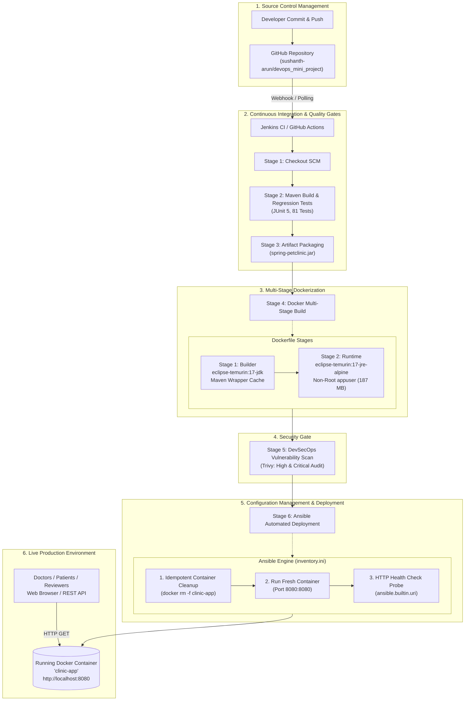

# Automated CI/CD Pipeline and Configuration Management for a Healthcare Clinic Management System

[](https://github.com/sushanth-arun/devops_mini_project/actions/workflows/ci-cd.yml)
[-blue.svg?logo=docker)](https://hub.docker.com/)
[](https://ansible.com/)
[](https://trivy.dev/)
[-orange.svg?logo=openjdk)](https://adoptium.net/)
[](https://spring.io/projects/spring-boot)
[](https://www.psgitech.ac.in/)

---

## 🏥 Project Overview

In clinical and healthcare settings, software updates must never cause unexpected service downtime. This mini-project implements a robust, enterprise-grade **Automated CI/CD Pipeline, DevSecOps Security Audit, and Configuration Management Framework** for a Spring Boot **Healthcare Clinic Management System** (Spring PetClinic).

The system automates the complete lifecycle:
1. **Continuous Integration (CI):** Automated checkout, Maven compilation, and JUnit 5 regression testing.
2. **Containerization (Docker):** Highly optimized multi-stage build creating an ultra-lean 187 MB Alpine runtime with non-root security hardening.
3. **DevSecOps (Trivy):** Container vulnerability scanning auditing for HIGH and CRITICAL CVEs without breaking build velocity.
4. **Configuration Management & Continuous Deployment (CD):** Idempotent container lifecycle provisioning via Ansible (`inventory.ini` and `deploy.yml`) with automated HTTP health check verification.
5. **Dual CI/CD Orchestration:** Local automation via Jenkins Declarative Pipeline (`Jenkinsfile`) and cloud mirror via GitHub Actions (`.github/workflows/ci-cd.yml`).

---

## 📐 Architecture & Pipeline Flow



---

## 🧰 Technology Stack

| Layer | Technology | Version | Purpose in Project |
|---|---|---|---|
| **Application** | Spring Boot / Java | 4.1.0 / 17 (Temurin) | Core Healthcare Clinic Microservice (Owners, Vets, Pets, Visits) |
| **Build Automation** | Apache Maven Wrapper | 3.9.x (`mvnw`) | Dependency resolution, compilation, packaging, reproducible builds |
| **Testing** | JUnit 5 & Spring Test | Latest | Automated regression unit tests (81 test cases) |
| **CI Automation (Local)** | Jenkins Declarative Pipeline | 2.580.x | Pipeline as Code (`Jenkinsfile`) with cross-platform `isUnix()` |
| **CI Automation (Cloud)** | GitHub Actions | Workflows v4/v5 | Cloud CI mirror on push/PR (`.github/workflows/ci-cd.yml`) |
| **Containerization** | Docker Multi-Stage | 29.x | Stage 1 (JDK 17) + Stage 2 (Alpine JRE 17), 187 MB footprint |
| **DevSecOps** | Aqua Security Trivy | Latest | Vulnerability audit for HIGH/CRITICAL CVEs |
| **Configuration Mgmt** | Ansible Core | 2.20.x | Idempotent container lifecycle provisioning (`deploy.yml`) |
| **Host OS** | Windows 11 + WSL2 Ubuntu | Linux 6.x | Hybrid cross-platform deployment architecture |

---

## 📋 Repository Structure

```
├── .github/
│   └── workflows/
│       └── ci-cd.yml          # GitHub Actions Cloud CI/CD workflow
├── .mvn/                      # Maven Wrapper binary & configuration
├── src/                       # Healthcare Clinic Application Source Code
├── Dockerfile                 # Optimized multi-stage Docker build file
├── .dockerignore              # Docker build context exclusion rules
├── Jenkinsfile                # 6-Stage Declarative Pipeline as Code
├── inventory.ini              # Ansible inventory pointing to deployment targets
├── deploy.yml                 # Ansible idempotent deployment & healthcheck playbook
├── demo_run.ps1               # One-click PowerShell automated verification script
├── REVIEW_GUIDE.md            # Detailed PSG iTech / Anna University review guide
├── pom.xml                    # Maven Project Object Model & dependencies
└── README.md                  # Project portfolio documentation (this file)
```

---

## ⚡ Quickstart & Live Demo

### Option 1: One-Click Demo Runner (Recommended for Review)
Run the automated PowerShell verification script:

```powershell
# Executes: Pre-flight check -> Docker Build -> Trivy Scan -> Ansible Deploy -> Health Check -> Auto-Launch Browser
.\demo_run.ps1
```

#### Handy Demo Flags:
```powershell
# Fast redeploy (skips build, executes Ansible deployment immediately)
.\demo_run.ps1 -DeployOnly

# Fast build (skips Trivy scan for faster rerun)
.\demo_run.ps1 -SkipScan

# Clean teardown of clinic-app container
.\demo_run.ps1 -Stop
```

---

### Option 2: Step-by-Step Manual Execution

#### 1. Run Maven Regression Tests:
```bash
./mvnw clean test
```

#### 2. Build Multi-Stage Docker Image:
```bash
docker build -t clinic-management:latest .
```

#### 3. Run DevSecOps Vulnerability Scan:
```bash
docker run --rm -v /var/run/docker.sock:/var/run/docker.sock \
  aquasec/trivy:latest image \
  --severity HIGH,CRITICAL \
  --exit-code 0 \
  clinic-management:latest
```

#### 4. Deploy with Ansible:
```bash
ansible-playbook -i inventory.ini deploy.yml
```

---

## 🌐 Live Service Endpoints

Once deployed, the healthcare management system is active at:

| Endpoint | Method | Expected HTTP Status | Description |
|---|---|---|---|
| `http://localhost:8080/` | `GET` | `200 OK` | Healthcare Clinic Web Portal UI |
| `http://localhost:8080/owners` | `GET` | `200 OK` | Patient / Pet Owner Management |
| `http://localhost:8080/vets.html` | `GET` | `200 OK` | Doctor / Veterinarian Directory |
| `http://localhost:8080/actuator/health` | `GET` | `200 OK` | Spring Boot Actuator Health Probe |
| `http://localhost:8081/` | `GET` | `200/403` | Local Jenkins CI/CD Dashboard |

---

## 🔒 DevSecOps & Security Hardening Features

1. **Non-Root Container User:** Application executes under unprivileged system user `appuser:appgroup`, mitigating container breakout vulnerabilities.
2. **Minimal Attack Surface:** Built upon `eclipse-temurin:17-jre-alpine`, omitting shell package managers and compilers in production.
3. **Automated Trivy Scanning:** Continuous vulnerability auditing in both Jenkins (`Jenkinsfile`) and GitHub Actions (`ci-cd.yml`).
4. **Deterministic Layer Caching:** Dependencies and Maven Wrapper are cached in early layers, guaranteeing rapid and reproducible builds.
5. **Graceful Signal Handling:** Uses `exec java $JAVA_OPTS -jar app.jar` in `ENTRYPOINT` to ensure `SIGTERM` signals reach the JVM for clean database connection drain.

---

## 🎓 Academic Review Information

- **Institution:** PSG Institute of Technology and Applied Research (PSG iTech), Neelambur, Coimbatore
- **Affiliated To:** Anna University, Chennai
- **Department:** Computer Science and Engineering / Information Technology
- **Course:** 5th Semester — DevOps Laboratory Mini-Project
- **Repository:** [https://github.com/sushanth-arun/devops_mini_project](https://github.com/sushanth-arun/devops_mini_project)
- **Detailed Viva Q&A Guide:** Refer to [`REVIEW_GUIDE.md`](./REVIEW_GUIDE.md) for top 5 viva questions and answers.
