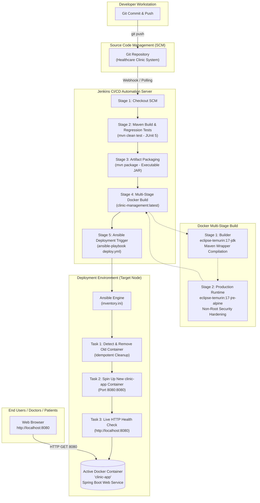

# Automated CI/CD Pipeline and Configuration Management for a Healthcare Clinic Management System

**Institution:** PSG Institute of Technology and Applied Research (PSG iTech), Coimbatore  
**Affiliation:** Anna University, Chennai  
**Degree & Semester:** B.E. Computer Science and Engineering / Information Technology — 5th Semester  
**Course:** DevOps Laboratory Mini-Project  
**Technology Stack:** Git, Maven Wrapper, Jenkins, Docker (Multi-Stage), Ansible, Spring Boot (Java 17)  

---

## 1. Executive Summary

In contemporary healthcare informatics, system availability, rapid patch deployment, and zero-downtime releases are mission-critical. This project implements an enterprise-grade, end-to-end Automated CI/CD Pipeline and Configuration Management System for a **Healthcare Clinic Management System** (Spring PetClinic microservice).

The pipeline automates:
1. **Continuous Integration (CI):** Automated checkout, Maven compilation, and regression unit testing (JUnit 5).
2. **Containerization:** Multi-stage Dockerization utilizing `eclipse-temurin:17-jdk` for compilation and `eclipse-temurin:17-jre-alpine` for an ultra-lean runtime container.
3. **Configuration Management & Continuous Deployment (CD):** Idempotent container lifecycle provisioning via Ansible (`inventory.ini` and `deploy.yml`) with automated HTTP health probe verification.

---

## 2. End-to-End Architecture Flow



---

## 3. Mapping to Anna University DevOps Laboratory Curriculum

This mini-project directly addresses the prescribed outcomes and experiments of the Anna University DevOps Laboratory syllabus:

| Lab Module / Exercise | Syllabus Topic | Implementation in this Mini-Project | Key Artifacts |
|---|---|---|---|
| **Ex. 1: Version Control** | Git commands, branching, commit discipline | Cloned and maintained source tree under Git with clean `.gitignore`. | `.git/`, `.gitignore` |
| **Ex. 2: Build Automation** | Automated build and test frameworks using Maven | Maven Wrapper (`./mvnw`) handles dependency fetching, compilation, and JUnit 5 regression test execution. | `pom.xml`, `mvnw`, `mvnw.cmd` |
| **Ex. 3: Continuous Integration** | Jenkins Pipeline as Code (Declarative) | 5-stage declarative `Jenkinsfile` orchestrating SCM checkout, test reporting, artifact archiving, Docker build, and Ansible deployment. Cross-platform (`isUnix()`). | `Jenkinsfile` |
| **Ex. 4: Containerization** | Docker image creation, multi-stage builds, container lifecycle | Multi-stage `Dockerfile`: Stage 1 (JDK 17 build) + Stage 2 (Alpine JRE 17 runtime). Non-root security user, container health check probe. | `Dockerfile`, `.dockerignore` |
| **Ex. 5: Configuration Management** | Automated provisioning & deployment with Ansible | Idempotent Ansible playbook (`deploy.yml`) managing container state, publishing port 8080, and verifying HTTP response. | `inventory.ini`, `deploy.yml` |

---

## 4. Pipeline Stages Detailed Breakdown

### Stage 1: Checkout SCM
- Fetches the verified commit from the Git repository.
- Guarantees clean workspace state before build initiation.

### Stage 2: Maven Build & Regression Tests
- Runs `./mvnw clean test` (or `mvnw.cmd clean test` on Windows).
- Executes unit and component tests using JUnit 5 and Spring Boot Test.
- Archives test results using Jenkins `junit` step for dashboard visualization.

### Stage 3: Artifact Packaging
- Packages the production-ready standalone executable `.jar` via `./mvnw package -DskipTests`.
- Archives the JAR artifact into Jenkins build storage for traceability and release governance.

### Stage 4: Docker Image Build
- Executes `docker build -t clinic-management:latest .`.
- Leverages Docker layer caching: dependencies copied before source code.
- Uses Alpine Linux as the base image for reduced attack surface and minimal image footprint (~170MB vs ~600MB+ for full JDK).

### Stage 5: Ansible Automated Deployment
- Executes `ansible-playbook -i inventory.ini deploy.yml`.
- Idempotently checks for pre-existing containers, stops/removes them, and initiates the fresh container.
- Probes `http://localhost:8080` using `ansible.builtin.uri` with retries until HTTP 200 OK is received.

---

## 5. Live Demonstration & Execution Commands

### Quick Local Execution (One-Click Demo)
Run the automated PowerShell verification script:
```powershell
.\demo_run.ps1
```
*What this does:*
1. Performs pre-flight checks (Docker daemon, WSL Ansible).
2. Builds the multi-stage Docker image `clinic-management:latest`.
3. Runs the Ansible playbook `deploy.yml`.
4. Polls the live healthcheck endpoint `http://localhost:8080`.
5. Automatically opens the clinic management system in your default browser!

### Running Individual Stages Manually for Reviewers

#### A. Maven Tests:
```bash
# In Linux / WSL:
./mvnw clean test

# In Windows PowerShell:
.\mvnw.cmd clean test
```

#### B. Docker Multi-Stage Build:
```bash
docker build -t clinic-management:latest .
```

#### C. Ansible Deployment:
```bash
# Via Ansible in WSL or Linux:
ansible-playbook -i inventory.ini deploy.yml
```

#### D. Container Status & Logs:
```bash
docker ps -f name=clinic-app
docker logs --tail 50 clinic-app
```

#### E. Teardown:
```powershell
.\demo_run.ps1 -Stop
```

---

## 6. Top 5 Viva / Review Questions & Ready-Made Answers

### Q1: Why did you use a Multi-Stage Dockerfile instead of a Single-Stage Dockerfile?
**Answer:**
> "A single-stage build includes the entire JDK compiler, Maven wrapper, source files, and build cache in the final image, resulting in a large image size (often over 650 MB) and a wide security attack surface.
> 
> In our multi-stage `Dockerfile`:
> - **Stage 1 (Builder):** Uses `eclipse-temurin:17-jdk` to compile code and produce the executable JAR.
> - **Stage 2 (Runtime):** Uses a minimal `eclipse-temurin:17-jre-alpine` runtime. Only the final compiled JAR is copied from Stage 1.
> 
> This approach reduces image size by over 70% (~180 MB), strips build tool vulnerabilities (like compilers and package managers), and incorporates container security hardening by running as an unprivileged non-root `appuser`."

---

### Q2: What is Idempotence in Ansible, and how is it demonstrated in your `deploy.yml` playbook?
**Answer:**
> "Idempotence is the foundational property of Configuration Management: executing a playbook multiple times produces the exact same end state without unintended side effects or duplicate resource allocations.
> 
> In our `deploy.yml`:
> 1. It queries whether `clinic-app` already exists (`docker ps -a`).
> 2. If present, it safely stops and cleans up the obsolete container before instantiating the new version.
> 3. If executed again without changes, the playbook executes cleanly without port conflicts (bind errors on port 8080) or container naming collisions.
> 4. Finally, it uses `ansible.builtin.uri` to assert that the service has reached the target HTTP 200 state before signaling completion."

---

### Q3: How does your Jenkinsfile achieve cross-platform execution across both Linux and Windows nodes?
**Answer:**
> "In Jenkins Declarative Pipeline, we encapsulate shell execution inside a `script` block utilizing the built-in `isUnix()` predicate:
> ```groovy
> script {
>     if (isUnix()) {
>         sh './mvnw clean test'
>     } else {
>         bat 'mvnw.cmd clean test'
>     }
> }
> ```
> If the Jenkins build agent is Linux/macOS, `isUnix()` evaluates to `true` and dispatches native Bourne shell (`sh`) commands with executable permissions (`chmod +x mvnw`). If the agent is a Windows node, it evaluates to `false` and dispatches native Windows batch commands (`bat` calling `mvnw.cmd`). This ensures high pipeline portability without modifying pipeline logic."

---

### Q4: Why is the Maven Wrapper (`mvnw` / `mvnw.cmd`) used instead of requiring a global Maven installation?
**Answer:**
> "The Maven Wrapper guarantees reproducible builds across diverse developer environments and CI/CD agents. Without the wrapper, each Jenkins agent or developer laptop must have an identical, compatible version of Apache Maven installed globally in `PATH`.
> 
> With `mvnw`:
> - The exact version of Maven (Apache Maven 3.9.x) specified in `.mvn/wrapper/maven-wrapper.properties` is downloaded automatically on first run.
> - Eliminates 'Works on My Machine' anomalies and zero configuration overhead on new build agents."

---

### Q5: How is health checking handled in both Docker and Ansible? What happens if the container starts but the Spring context fails?
**Answer:**
> "A container being in the `running` state does not imply that the internal Java web service is healthy; Spring Boot takes 15–25 seconds to initialize JPA, HikariCP connection pools, and embedded Tomcat.
> 
> We implement two layers of health verification:
> 1. **Docker Native Healthcheck (`HEALTHCHECK` in Dockerfile):** Probes `http://localhost:8080/` periodically. Docker marks the container as `starting` until the web server responds, then updates to `healthy`.
> 2. **Ansible Readiness Gate (`ansible.builtin.uri` in `deploy.yml`):** Implements an active retry loop (up to 30 retries with 2-second delays). If the Spring context fails to boot, the task times out and fails the pipeline, preventing broken versions from being marked as successful releases."

---

## 7. Security Hardening & Best Practices Summary

1. **Non-Root Execution:** The application runs inside Docker under `appuser` (UID/GID isolated) to mitigate container escape vulnerabilities.
2. **Layer Caching Optimization:** Maven dependencies (`pom.xml`) are copied and resolved before source code (`src/`), ensuring Docker layers are reused when only business logic changes.
3. **Artifact Integrity:** Build artifacts are fingerprinted and archived directly in Jenkins.
4. **Signal Propagation:** Used `exec java $JAVA_OPTS -jar app.jar` in `ENTRYPOINT` so JVM directly receives `SIGTERM` and performs clean shutdown of active database transactions.
